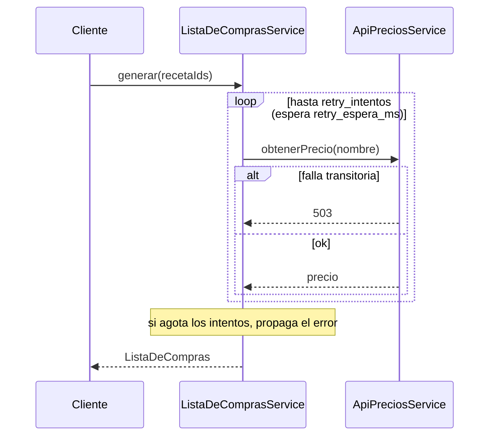
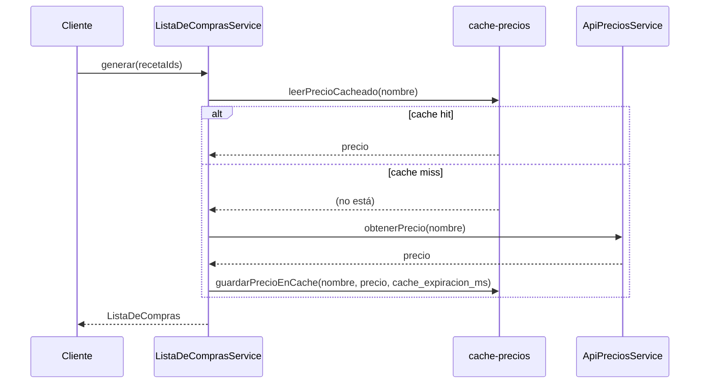
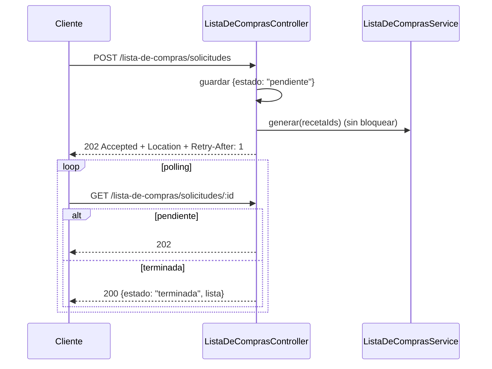
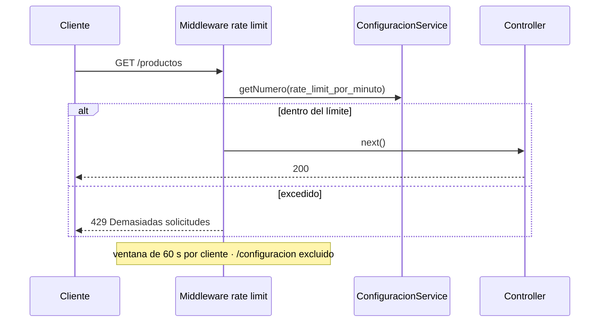
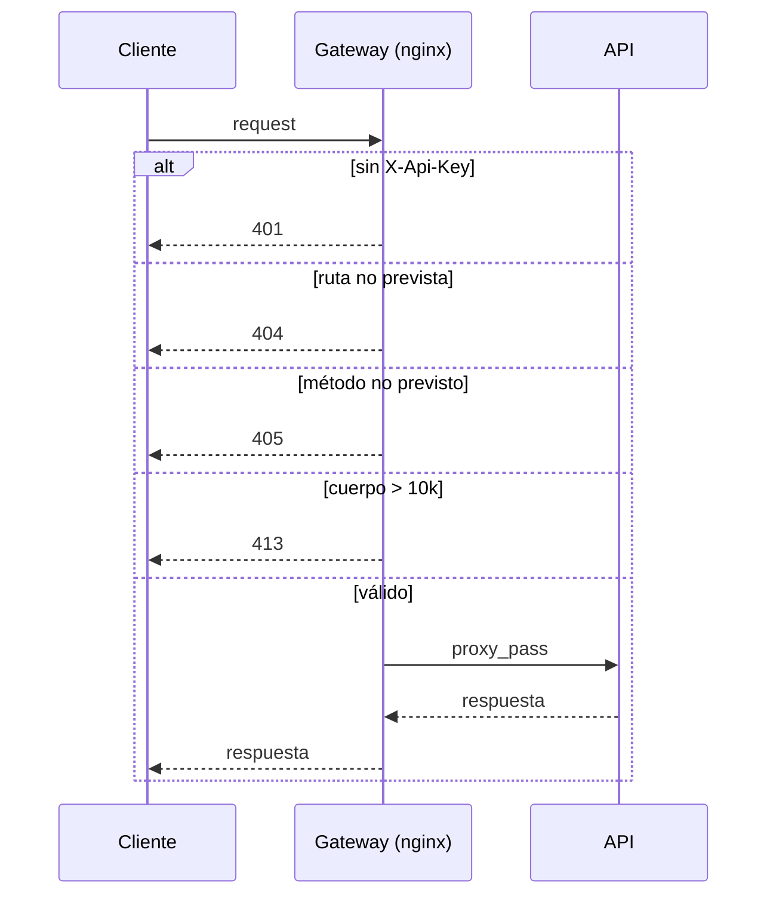

# Diagramas de secuencia — aplicación de los patrones

Diagramas de secuencia que muestran la aplicación de los
patrones de disponibilidad y de rendimiento. Los diagramas estructurales
(clases de dominio, clases de infraestructura, componentes y despliegue) están
en [`recetario.drawio.xml`](recetario.drawio.xml).

## Retry (disponibilidad)

## Cache-aside (rendimiento)

## Asynchronous request-reply (rendimiento)

## Rate limit (disponibilidad)

## Gatekeeper (seguridad)

Complementa al diagrama de despliegue: muestra el orden de los filtros en el borde.

