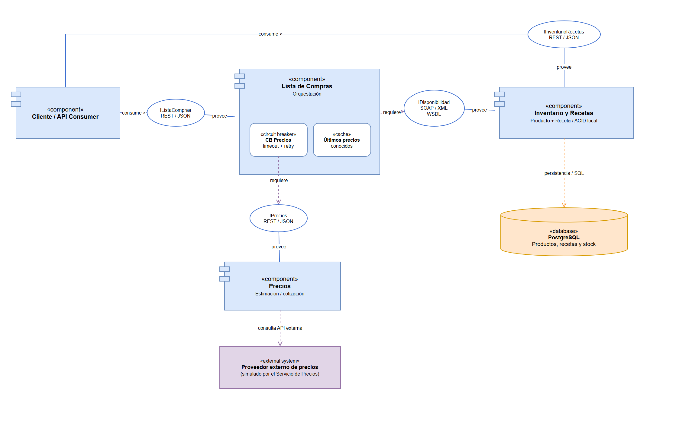
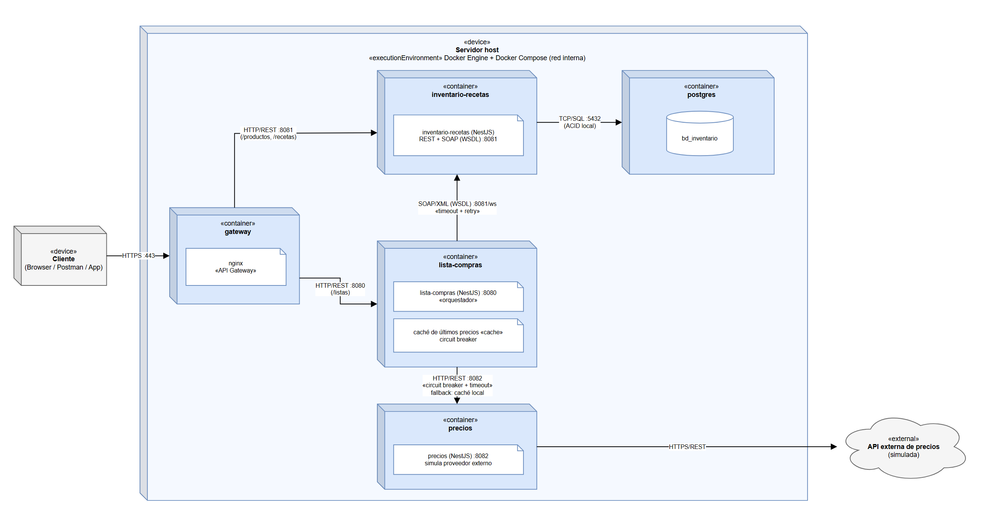
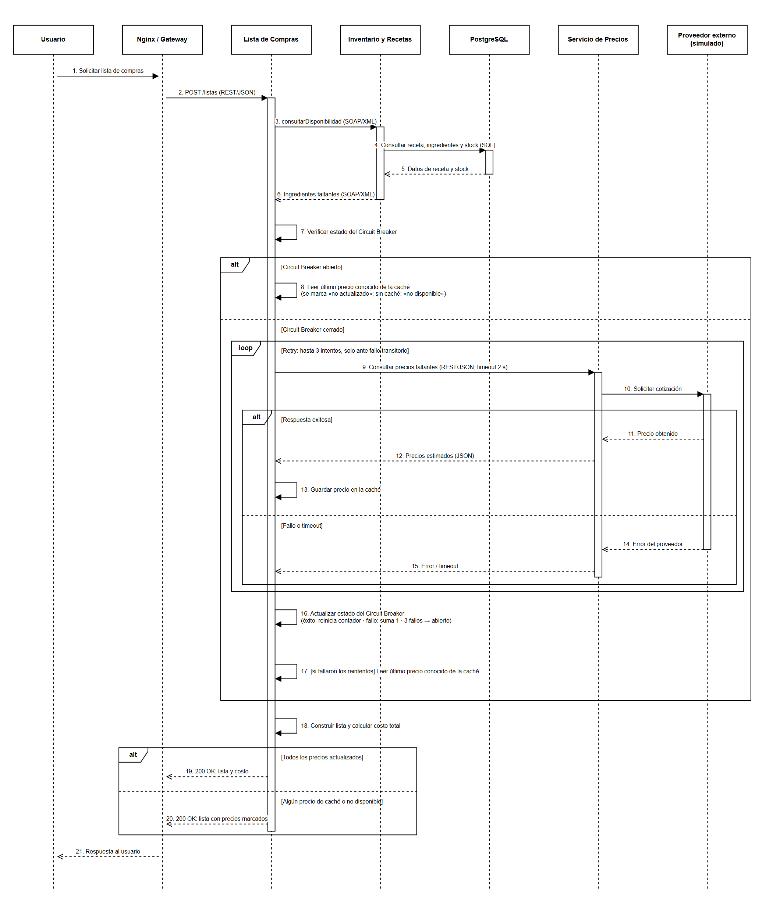

> **Copia del documento final de la Parte 1 del TFU 5**, exportada del Google Doc "TFU 5 ANDIS 2" el 2026-11-08.
> Es el diseño entregado y cerrado: la Parte 2 lo implementa tal cual. No editar este archivo a mano; si el Doc cambia, se vuelve a exportar.

UT5-TFU  
ESTILOS DE ARQUITECTURA

**GRUPO 6**

DIEGO GAMARRA  
JUAN MARTINEZ  
NICOLÁS DEL CAMPO  
FELIPE ALONSO

9 de Noviembre 2026

# Introducción

En las entregas anteriores desarrollamos un recetario que permite gestionar ingredientes y su stock, definir recetas, cocinarlas descontando automáticamente los ingredientes utilizados y generar listas de compras con los ingredientes faltantes y su costo estimado. Esa solución se construyó como un monolito particionado por dominio: todos los componentes se ejecutaban en un mismo proceso, compartían una única base de datos y se desplegaban como una sola unidad.

En este trabajo evolucionamos la aplicación hacia un estilo arquitectónico distribuido, específicamente una Arquitectura Orientada a Servicios (SOA). El documento justifica la elección del nuevo estilo frente a las alternativas estudiadas, presenta los modelos UML de la nueva arquitectura (componentes, despliegue y secuencia), compara ambas arquitecturas, analiza las falacias de la computación distribuida que afectan a la solución junto con los patrones aplicados para mitigarlas, y define el atributo de calidad que esperamos mejorar —la disponibilidad— junto con las pruebas que lo validarán en la Parte 2\.

El eje del trabajo es el paso de un sistema donde los componentes se comunicaban mediante llamadas internas a uno donde se comunican a través de la red, con todo lo que eso implica: fallos parciales, latencia y la necesidad de diseñar explícitamente cómo se comporta el sistema cuando una de sus partes no responde.

# Identificación y Justificación

La arquitectura implementada en la versión anterior de nuestra solución fue de tipo monolítico, organizada mediante una partición por dominio con cuatro componentes principales encargados de áreas específicas del negocio:

* **Producto:** encargado de administrar los ingredientes, su disponibilidad y stock.  
* **Recetas:** encargado de gestionar las recetas, los ingredientes necesarios y el proceso de cocción.  
* **API de Precios:** encargada de consultar a un proveedor externo los precios de los productos.  
* **Lista de Compras:** encargada de determinar los ingredientes faltantes y sus costos.

Estos componentes se comunicaban mediante llamadas directas y mantenían un despliegue centralizado a través de Docker.

Para el nuevo estilo arquitectónico del sistema se seleccionó una Arquitectura Orientada a Servicios (SOA).

SOA nos permite organizar el sistema como servicios con responsabilidades definidas, interfaces explícitas y contratos. Estos servicios pueden ser consumidos por distintos procesos, favoreciendo la capacidad para intercambiar datos, utilizar información, reutilización de capacidades de negocio y separación de responsabilidades.

En nuestra propuesta, los componentes existentes se reorganizan en tres servicios principales:

* **Servicio de Inventario y Recetas:** responsable de gestionar productos, stock, recetas, disponibilidad de ingredientes y operaciones de cocina.  
* **Servicio de Lista de Compras:** responsable de coordinar la obtención de ingredientes faltantes y sus precios para generar listas de compras.  
* **Servicio de Precios:** responsable de proporcionar estimaciones de precios de los productos.

Decidimos que el Servicio de Lista de Compras actuará como coordinador del proceso de generación de listas, invocando los servicios necesarios y gestionando sus respuestas. De esta manera, se aplicará una orquestación ligera sin incorporar un motor de orquestación independiente.

Los servicios se ejecutarán en procesos independientes y se comunicarán mediante contratos explícitos a través de la red. Se propone utilizar SOAP/XML con WSDL para la consulta de disponibilidad de recetas, manteniendo REST/JSON en las operaciones donde resulte conveniente.

Además, se decidió conservar la gestión de Producto y Receta dentro de un mismo servicio, ya que consideramos importante mantener las garantías ACID necesarias para descontar correctamente los ingredientes al cocinar una receta manteniendo una consistencia de stock. 

La elección de SOA frente a otras arquitecturas se debe a varios motivos, uno de los más importantes es la posibilidad de reutilización de servicios. La aplicación ya dispone de funcionalidades como la consulta de productos, la verificación de disponibilidad de ingredientes y la estimación de precios, que pueden ser utilizadas por diferentes procesos del negocio. Estas capacidades podrán ser consumidas por distintos servicios sin necesidad de duplicar su implementación. Facilitando el mantenimiento y permitiendo incorporar nuevas funcionalidades aprovechando las ya existentes.

Otros motivos para la decisión fueron la coordinación, el monitoreo y la trazabilidad de los procesos. Para realizar una lista de compras requerimos consultar las recetas, identificar los ingredientes faltantes y obtener sus precios, funcionalidad que requiere coordinación con múltiples servicios.

Frente a una arquitectura de microservicios, que permitiría una mayor autonomía, así como despliegue y escalabilidad independientes por servicio, SOA evita la complejidad de administración, comunicación y gestión de datos distribuidos que implica una granularidad tan fina, difícil de sostener para un equipo pequeño. Además, el principio de una base de datos por servicio llevaría a separar Producto y Receta, con lo que la operación de cocinar dejaría de ser una transacción ACID local y requeriría mecanismos como sagas con consistencia eventual.

Por su parte la tercera opción de arquitectura basada en eventos ofrece ventajas en el desacoplamiento temporal y el procesamiento asíncrono, permitiendo que diferentes componentes reaccionen ante eventos sin depender de respuestas inmediatas. Esto podría resultar útil para futuras funcionalidades, como notificaciones por bajo stock o registros de recetas. Sin embargo, los principales procesos actuales del recetario requieren consultas y respuestas inmediatas, por lo que una arquitectura principalmente basada en eventos incorporaría complejidad adicional en la gestión de mensajes, duplicados y consistencia, haciendo que sus beneficios no justifiquen su elección como arquitectura principal.

Las desventajas principales que encontramos en la arquitectura SOA son una mayor complejidad distribuida debido a la necesidad de gestionar la comunicación entre procesos y posibles fallos de red, la dependencia de contratos estrictos para mantener la compatibilidad entre interfaces, y una latencia adicional generada por las comunicaciones remotas. Asimismo, se suman la dependencia del coordinador, ya que si el Servicio de Lista de Compras falla los procesos que coordina pueden quedar interrumpidos, posibles cuellos de botella derivados de una coordinación centralizada que podría limitar el rendimiento en alta demanda, y un mayor esfuerzo de pruebas requerido para verificar no solo cada servicio de forma individual, sino también sus interacciones. 

# Modelado de la arquitectura SOA

## Diagrama de componentes

El diagrama muestra los tres servicios y sus interfaces. El cliente consume IListaCompras, provista por Lista de Compras, e IInventarioRecetas, provista por Inventario y Recetas, ambas REST/JSON. Lista de Compras requiere IDisponibilidad, el único contrato SOAP/XML descrito con WSDL, e IPrecios (REST/JSON). El Circuit Breaker y la caché de últimos precios se ubican dentro de Lista de Compras, sobre la dependencia hacia Precios. Inventario y Recetas es el único servicio con acceso a la base de datos, lo que mantiene local la transacción ACID de cocinar una receta.

## Diagrama de despliegue

Cada servicio se ejecuta en su propio contenedor Docker. Los contenedores se orquestan con Docker Compose en un mismo servidor y se comunican por la red interna de Docker. Un gateway (nginx) recibe todas las solicitudes del cliente y las enruta según la ruta: /listas a Lista de Compras, y /productos y /recetas a Inventario y Recetas. El gateway no contiene lógica de negocio; por eso, si se detiene el contenedor de Lista de Compras, las operaciones de Inventario y Recetas siguen disponibles. La base de datos PostgreSQL corre en un contenedor propio al que solo accede Inventario y Recetas.

## Diagrama de secuencia

El diagrama describe el caso de uso «Generar lista de compras». Lista de Compras consulta por SOAP los ingredientes faltantes y luego verifica el estado del Circuit Breaker antes de pedir los precios. Si el circuito está abierto, responde de inmediato con el último precio conocido de la caché. Si está cerrado, consulta al Servicio de Precios con timeout y reintentos acotados, guarda en la caché los precios obtenidos y actualiza el estado del Circuit Breaker según el resultado. La respuesta final indica qué precios no están actualizados o no están disponibles.

# Comparación entre arquitectura antigua y actual.

La arquitectura original del recetario desarrollada en las entregas anteriores corresponde a una estructura monolítica. Aunque sus componentes se encontraban separados mediante una partición por dominio, todo el sistema se ejecutaba dentro de un mismo proceso y la comunicación entre los módulos se realizaba a través de llamadas internas en memoria.

En contraposición, la nueva arquitectura orientada a servicios (SOA) establece una comunicación mediante interfaces y contratos explícitos, distribuyendo las responsabilidades en tres servicios independientes. Esto permite evolucionar desde una simple diferenciación lógica dentro del monolito hacia una separación real por dominio, aislando tanto la lógica de negocio como los entornos de ejecución y despliegue.

Esta transición introduce diferentes ventajas y compromisos entre ambos enfoques. En términos de distribución de responsabilidades, la independencia de los nuevos servicios facilita su evolución individual, aunque a costa de una mayor dificultad al momento de coordinar los flujos de negocio. En la comunicación, el uso de protocolos como REST/JSON y SOAP/XML a través de la red introduce una latencia inevitable en comparación con las llamadas internas directas del monolito. Asimismo, el despliegue evoluciona desde una entrega única y centralizada hacia un esquema distribuido que permite actualizar e implementar cada servicio de forma totalmente independiente.

Al analizar los atributos de calidad, el monolito presenta una clara ventaja en el rendimiento para una demanda predecible al no sufrir de latencia en la red. Sin embargo, la solución orientada a servicios favorece sensiblemente la modificabilidad y la escalabilidad, dado que permite asignar recursos informáticos y actualizar funcionalidades específicas sin afectar al resto del sistema. Del mismo modo, la disponibilidad global mejora debido a que las fallas en un servicio no interrumpen necesariamente aquellas operaciones que no dependan directamente de él.

En conclusión, la nueva arquitectura ofrece beneficios significativos en escalabilidad y mantenibilidad frente a la solución monolítica, pero añade desafíos vinculados a la latencia y a la complejidad de las comunicaciones distribuidas. Por esta razón, el modelo orientado a servicios no representa una mejora absoluta frente al monolítico, sino una alternativa cuyas ventajas estratégicas dependen directamente del volumen de usuarios, el tamaño del equipo de desarrollo y las prioridades operativas del proyecto.

# Falacias de la computación distribuida y patrones arquitectónicos.

La transición del recetario desde un monolito modular hacia una arquitectura SOA introduce nuevos desafíos asociados a la comunicación entre servicios independientes.

Las falacias de la computación distribuida representan suposiciones incorrectas que pueden llevar a problemas de diseño cuando se construyen sistemas distribuidos.

Para nuestra arquitectura se seleccionaron dos falacias especialmente relevantes: la confiabilidad de la red y la ausencia de latencia.

## Falacia 1: "La red es confiable"

**Dónde afecta a la solución.** El Servicio de Lista de Compras depende de dos servicios remotos para cumplir su función: el Servicio de Inventario y Recetas (consulta de disponibilidad vía SOAP) y el Servicio de Precios (estimación de precios vía REST). En el monolito estas eran llamadas internas que no podían fallar por causas de red; ahora cualquiera de ellas puede fallar porque el servicio destino está caído, reiniciándose o porque la red pierde la conexión.

**Qué problema ocasionaría.** Sin un tratamiento explícito, la caída del Servicio de Precios haría fallar la generación completa de la lista de compras, aun cuando la información principal —qué ingredientes faltan— sí está disponible. Un fallo en una dependencia secundaria se propagaría al usuario como un error total.

**Análisis de las dependencias.** No todas las dependencias tienen el mismo peso:

| Dependencia | ¿Se puede seguir sin ella? | Decisión |
| :---- | :---- | :---- |
| Inventario y Recetas | No. Sin saber qué falta no existe lista posible. | Reintento ante fallos transitorios; si persiste, error controlado (503) con mensaje claro. No se usa caché de stock porque el stock cambia con cada receta cocinada y una lista basada en stock desactualizado sería incorrecta. |
| Precios | Sí. La lista sigue siendo útil aunque los precios no sean actuales. | Reintento \+ Circuit Breaker \+ fallback con caché del último precio conocido. |

**Patrones aplicados.**

* **Retry (reintento):** ante un fallo puntual de red se reintenta la llamada una cantidad acotada de veces (por ejemplo, 2 reintentos con espera creciente entre ellos). Resuelve los fallos transitorios, que son los más frecuentes.  
* **Circuit Breaker:** envuelve las llamadas al Servicio de Precios. Funciona con tres estados:  
  * *Cerrado:* las llamadas pasan normalmente. Si se acumulan fallos consecutivos (por ejemplo, 3), el circuito se abre.  
  * *Abierto:* no se realizan llamadas al servicio; se responde inmediatamente con el fallback. Pasado un tiempo de espera (por ejemplo, 10 segundos), pasa a semiabierto.  
  * *Semiabierto:* se permite una llamada de prueba. Si tiene éxito el circuito se cierra; si falla, vuelve a abrirse.  
* **Fallback con caché del último precio conocido:** cada vez que el Servicio de Lista de Compras obtiene un precio correctamente, lo guarda. Cuando el circuito está abierto o la llamada falla, la lista se arma con el último precio conocido, marcado explícitamente como "precio no actualizado". Si nunca se obtuvo un precio para ese producto, se informa "precio no disponible".

**Justificación de la elección.** El reintento por sí solo no alcanza: ante un fallo sostenido (el servicio caído durante minutos), reintentar cada solicitud solo agrega carga y demora sin posibilidad de éxito. El Circuit Breaker detecta ese fallo sostenido y deja de insistir. A su vez, el Circuit Breaker solo decide *si* llamar; el fallback decide *qué devolver* cuando no se llama. La combinación de los tres permite que el sistema se degrade de forma controlada en lugar de fallar por completo.

**Compromiso asumido.** Al usar precios en caché priorizamos la disponibilidad por sobre la exactitud del dato: el usuario puede recibir un precio desactualizado. Lo consideramos aceptable porque los precios de la lista son estimaciones orientativas para la compra, no un valor que se cobre, y el sistema siempre indica cuándo un precio no está actualizado.

## Falacia 2: "La latencia es cero"

**Dónde afecta a la solución.** Cada llamada entre servicios tiene ahora un costo de red. El Servicio de Precios, al simular un proveedor externo, presenta una latencia variable. Generar una lista implica al menos dos llamadas remotas encadenadas (disponibilidad y luego precios).

**Qué problema ocasionaría.** Si el Servicio de Precios responde muy lento o queda colgado, el Servicio de Lista de Compras quedaría esperando indefinidamente, manteniendo recursos ocupados. Bajo carga, esas esperas se acumulan y el coordinador puede saturarse, propagando la lentitud de un servicio a todo el flujo (fallo en cascada).

**Decisiones y patrones aplicados.**

* **Timeout:** toda llamada remota tiene un tiempo máximo de espera (por ejemplo, 2 segundos). Superado ese tiempo, la llamada se considera fallida y cuenta como fallo para el Circuit Breaker.  
* **Circuit Breaker (fail fast):** con el circuito abierto, el Servicio de Lista de Compras ni siquiera intenta la llamada y responde en milisegundos usando el fallback, en lugar de esperar el timeout en cada solicitud.  
* **Consultas agrupadas:** el Servicio de Lista de Compras solicita los precios de todos los ingredientes faltantes en una sola llamada, en lugar de una llamada por ingrediente, reduciendo la cantidad de viajes por la red.  
* **Operaciones transaccionales locales:** la operación de cocinar una receta, que descuenta stock de varios productos, se mantiene dentro de un único servicio. Además de preservar las garantías ACID, evita que una operación crítica dependa de múltiples llamadas remotas.

**Justificación de la elección.** El timeout acota el peor caso de cada llamada individual; el Circuit Breaker evita pagar ese peor caso repetidamente cuando el servicio ya sabemos que está fallando.

## Representación en los modelos

* **Diagrama de componentes:** el Circuit Breaker y la caché de precios se representan dentro del Servicio de Lista de Compras, en la dependencia hacia la interfaz del Servicio de Precios.  
* **Diagrama de despliegue:** la caché de últimos precios y el Circuit Breaker se ubican en el contenedor lista-compras, y las conexiones hacia Inventario y Recetas (SOAP, timeout y reintentos) y hacia Precios (REST, Circuit Breaker y timeout) indican el patrón que aplica cada una.  
* **Diagrama de secuencia:** el caso de uso "Generar lista de compras" muestra un fragmento alt con los dos caminos: circuito cerrado (se consulta al Servicio de Precios y se actualiza la caché) y circuito abierto o fallo (se responde con el último precio conocido).

# Atributo de calidad: Disponibilidad

## Atributo seleccionado

Seleccionamos la **disponibilidad**: la capacidad del sistema de seguir prestando sus funciones cuando alguna de sus partes falla. Si bien la nueva arquitectura también favorece la facilidad de modificación y de despliegue, la disponibilidad es el atributo que más directamente se ve afectado por el cambio a un sistema distribuido y el que podemos medir de forma concreta.

## Cómo contribuyen las decisiones arquitectónicas

* **Aislamiento de fallos por separación en procesos.** En el monolito, una falla que derribara el proceso dejaba inoperante toda la aplicación. Ahora cada servicio se ejecuta en su propio proceso y contenedor: si cae el Servicio de Lista de Compras, el Servicio de Inventario y Recetas sigue funcionando y se pueden consultar productos, recetas y cocinar.  
* **Degradación controlada mediante Circuit Breaker y fallback.** Si cae el Servicio de Precios, la generación de listas de compras sigue funcionando con los últimos precios conocidos, en lugar de fallar completamente.  
* **Timeouts.** Evitan que la lentitud de un servicio se traduzca en indisponibilidad del coordinador.

Es importante aclarar que la distribución por sí sola no mejora la disponibilidad: agrega más puntos de falla (más procesos y comunicaciones por red). La mejora proviene de combinar la separación en servicios con los patrones que manejan esos fallos parciales.

## Cómo se evaluará en la Parte 2

**Condiciones de ejecución:** todos los servicios desplegados con Docker Compose en un mismo equipo. Para simular fallos se detienen contenedores individuales (docker stop). Las solicitudes se envían mediante un script que realiza 100 solicitudes y registra código de respuesta y tiempo de respuesta de cada una.

**Escenarios:**

| \# | Escenario | Acción | Resultado esperado (SOA) | Comparación con el monolito |
| :---- | :---- | :---- | :---- | :---- |
| 1 | Línea base | Todos los servicios activos; se generan listas de compras | 100% de respuestas exitosas con precios actuales | Funcionamiento equivalente, con menor latencia en el monolito (sin llamadas de red) |
| 2 | Cae el Servicio de Precios | Se detiene el contenedor de Precios; se generan listas | Respuestas exitosas con precios en caché marcados como no actualizados | En el monolito no es posible detener solo el módulo de precios; si ese módulo falla sin manejo de errores, la solicitud completa falla |
| 3 | Cae Lista de Compras | Se detiene su contenedor; se cocina una receta | Cocinar funciona normalmente | En el monolito, la caída del proceso deja sin servicio a toda la aplicación |
| 4 | Recuperación | Se vuelve a levantar Precios | El circuito pasa de abierto a semiabierto y luego a cerrado; vuelven los precios actuales sin intervención manual | — |

**Métricas:**

* **Tasa de éxito:** porcentaje de solicitudes respondidas correctamente durante cada escenario.  
* **Tiempo de respuesta** con el circuito cerrado, con el circuito abierto, y sin Circuit Breaker (solo timeout), para evidenciar el beneficio de fallar rápido.

**Si no se verifica la mejora esperada,** analizaremos las causas posibles (por ejemplo, configuración de umbrales del Circuit Breaker o dependencias no contempladas) y documentaremos los compromisos identificados. En particular, esperamos que la latencia en el escenario base sea mayor que en el monolito, lo cual es un costo conocido y asumido de la distribución.

# Uso de herramientas de Inteligencia Artificial

## Herramientas utilizadas

* **Claude (Anthropic), a través de Claude Code:** utilizado para analizar la consigna y contrastarla con el documento en elaboración, discutir alternativas de diseño (granularidad de los servicios, manejo de fallos, elección del atributo de calidad), revisar la redacción, revisar la consistencia entre los diagramas UML y el texto, redibujar los diagramas según las correcciones acordadas por el grupo y asistir en la implementación de la Parte 2\.

## Prompts relevantes

A continuación, un resumen de las interacciones más significativas con la IA.

**Interacción 1 – Granularidad de los servicios: SOA vs. microservicios**

*Prompt:* "¿No sería microservicios? Pero dijimos que no los separamos por las transacciones que necesitan ser ACID. Entonces, dejame ver si entiendo: ¿la principal diferencia entre SOA y microservicios es que microservicios tiene todo separado y con su propia base de datos, y SOA mantiene algunas cosas juntas?"

*Respuesta (resumen):* la IA confirmó el razonamiento sobre ACID pero señaló que la diferencia planteada era incompleta. Explicó que SOA prioriza la reutilización de capacidades de negocio con servicios de granularidad gruesa, mientras que microservicios prioriza la autonomía con servicios de granularidad fina y una base de datos por servicio. Aclaró que SOA no prohíbe separar Producto y Receta, sino que fue una decisión del grupo: separarlos acercaría el diseño a microservicios y obligaría a reemplazar la transacción local por una saga con consistencia eventual.

**Interacción 2 – Manejo de fallos y elección del atributo de calidad**

*Prompt:* "¿La más expuesta a fallar? Lista de compras depende de Inventario y Receta. Fallar sí, pero reponerse ante el fallo si el otro servicio no está disponible. Si falla Inventario se paraliza todo, si falla Lista de Compras también; la única que podría fallar y el sistema seguir es la API externa."

*Respuesta (resumen):* la IA validó que no todas las dependencias tienen el mismo peso y que el Servicio de Precios es el candidato a degradación controlada mediante Circuit Breaker con fallback. Corrigió dos puntos: que la caída de Lista de Compras no paraliza todo el sistema (Inventario sigue operativo, lo cual es precisamente una ventaja frente al monolito) y que el Servicio de Precios no es realmente externo sino una simulación propia. Ante nuestra propuesta de usar "precios viejos", planteó la pregunta de dónde se almacenarían y ofreció dos alternativas: devolver la lista sin precios o mantener una caché del último precio conocido.

## Análisis crítico

Utilizamos la IA principalmente como interlocutor para poner a prueba nuestro razonamiento, no como fuente de decisiones cerradas. El proceso fue iterativo: planteábamos una idea, la IA la cuestionaba o señalaba sus límites, y ajustábamos la propuesta contrastándola con los conceptos del curso.

**Recomendaciones aceptadas y por qué.**

* *Mantener Producto y Receta en un mismo servicio.* La decisión ya estaba tomada por el grupo a partir del análisis de ACID de la entrega anterior; la IA aportó la formulación de que el límite del servicio lo define el límite de la transacción, y la consecuencia concreta de separarlos (necesidad de sagas y consistencia eventual), que reforzó nuestra justificación frente a microservicios.  
* *Circuit Breaker con fallback sobre el Servicio de Precios.* Lo aceptamos porque resuelve un problema concreto que identificamos nosotros (la lista no debería fallar porque falten los precios), en línea con la consigna de aplicar patrones a problemas reales y no solo para demostrar su uso.  
* *Disponibilidad como atributo principal.* Habíamos propuesto tres atributos (facilidad de despliegue, de modificación y disponibilidad). Aceptamos centrarnos en disponibilidad porque es el que se apoya directamente en los patrones elegidos y el que podemos medir con un escenario reproducible.

**Recomendaciones cuestionadas o ajustadas.**

* *Fallback: elegimos entre las alternativas propuestas.* La IA ofreció devolver la lista sin precios (más simple) o con caché del último precio conocido (más compleja). Elegimos la caché asumiendo explícitamente el compromiso de priorizar disponibilidad sobre exactitud, porque los precios son estimaciones y una lista con precios aproximados es más útil para el usuario que una sin precios.  
* *No cachear el stock.* Si bien la caché resuelve la caída de Precios, decidimos no extender la misma solución al Servicio de Inventario: una lista de compras basada en stock desactualizado sería directamente incorrecta, a diferencia de un precio aproximado.  
* *Terminología SOA vs. arquitectura basada en servicios.* La IA señaló que en el documento usábamos ambos términos indistintamente, cuando en la bibliografía son estilos distintos. Mantuvimos SOA porque nuestra solución utiliza contratos formales (WSDL), un servicio que coordina el flujo de negocio y el objetivo de reutilizar capacidades, y unificamos la terminología en todo el documento.  
* *Revisión de nuestras propias afirmaciones.* Al discutir los fallos, inicialmente afirmamos que la caída de Lista de Compras paralizaba todo el sistema. Al revisarlo concluimos que no es así, y que el aislamiento de fallos es justamente uno de los argumentos a favor de la nueva arquitectura.

Todas las decisiones finales fueron discutidas y validadas por el grupo, y cada integrante está en condiciones de justificarlas en base a los conceptos de la unidad.
